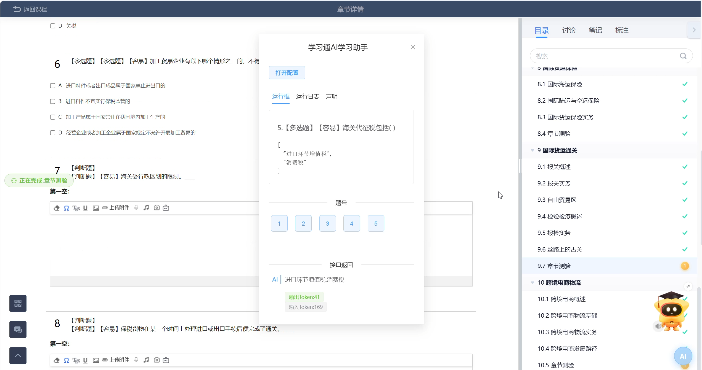

# 超星学习通 AI 学习助手

> 一款基于 AI 大语言模型的 [超星学习通（Chaoxing）](https://www.chaoxing.com) 自动学习与答题油猴脚本。  
> 纯 AI 作答，不依赖任何第三方题库；支持视频、文档、章节测验、作业、考试的全自动处理。

---

## 项目简介

本脚本通过调用兼容 OpenAI 协议的 AI 大模型（默认 **DeepSeek**），自动完成学习通中的各类任务：  
自动播放视频 / 音频、自动滚动文档、AI 智能答题并自动提交。

所有代码开源透明，**不含任何广告、追踪或题库付费墙**。API Key 仅保存在你本地浏览器中。

## 界面预览

> 上图为脚本悬浮窗（毛玻璃 AI 按钮 + 运行框 / 日志 / 声明）的真实运行截图。

---

## 功能特性

### AI智能答题（全题型覆盖）

- 支持：单选题、多选题、判断题、填空题、简答题、名词解释、论述题、计算题
- 每题独立调用 AI，内置 **三重重试**（遇 `429` / `503` 自动递增等待）
- 简答题通过提示词约束，输出纯净答案（无 Markdown 干扰符号）

### 全自动任务点

| 任务类型     | 行为                          |
| -------- | --------------------------- |
| 视频       | 静音自动播放至完成（建议不要倍速，可能会导致进程重置） |
| 任务点自动切换  | 节点任务完成后自动切换至下一个节点           |
| PPT / 文档 | 自动滚动至最后一页                   |
| 章节测验     | AI 答题 + 自动提交                |
| 作业/考试    | AI 答题 + 覆盖率安全检查             |

### 多模型支持

默认接入 DeepSeek V4 Flash，目前测试最稳定，可以流畅答题，还可自由切换任意 OpenAI 兼容端点：  
DeepSeek Pro、智谱 GLM、OpenAI、硅基流动（SiliconFlow）、豆包 等。

### 安全机制

- AI 答案覆盖率低于 **50%**（且题目数 > 2）时**拒绝提交**，防止空答案误交
- 并发锁防止任务重复执行
- 所有 API 调用均通过 HTTPS 加密

### 清爽界面

- 右下角毛玻璃圆形 **AI** 按钮，点击显隐悬浮窗运行框
- 接口返回区展示每道题的**输入 / 输出 Token** 真实消耗

---

## 支持的 AI 模型

| 模型           | API 地址（默认留空即 DeepSeek）                     | 模型名（示例）                   |
| ------------ | ------------------------------------------ | ------------------------- |
| DeepSeek（默认） | `https://api.deepseek.com`                 | `deepseek-chat`           |
| 智谱 GLM       | `https://open.bigmodel.cn/api/paas/v4`     | `glm-4-flash`             |
| OpenAI       | `https://api.openai.com/v1`                | `gpt-4o-mini`             |
| 硅基流动         | `https://api.siliconflow.cn/v1`            | `deepseek-ai/DeepSeek-V3` |
| 豆包           | `https://ark.cn-beijing.volces.com/api/v3` | 你的 Endpoint ID            |

> 只要是兼容 `/v1/chat/completions` 的服务，填入对应地址与模型名即可使用。

---

## 安装步骤

### 第一步：安装 Tampermonkey（篡改猴）

Tampermonkey 俗称「篡改猴」，是运行油猴脚本的浏览器扩展，**只需装一次**。按你的浏览器任选其一：

| 浏览器                            | 安装方式                                                                                                                             |
| ------------------------------ | -------------------------------------------------------------------------------------------------------------------------------- |
| Chrome / Edge / 360 极速 / 百分浏览器 | 打开 [Chrome 网上应用店](https://chrome.google.com/webstore/detail/tampermonkey/dhdgffkkebhmkfjojejmpbldmpobfkfo) 点击「添加至 Chrome / Edge」 |
| Firefox                        | 在 [Firefox Add-ons](https://addons.mozilla.org/zh-CN/firefox/addon/tampermonkey/) 点击「添加到 Firefox」                                |
| 无法访问应用商店                       | 前往 [Tampermonkey 官网](https://www.tampermonkey.net/) 下载对应浏览器版本手动安装                                                                |

安装完成后，点击浏览器右上角拓展/工具栏，会出现篡改猴(Tampermonkey)图标。点击图标 → 「管理面板」可进入脚本管理页。

### 第二步：添加本脚本

1. 在本仓库点击 `chaoxing-ai-llm.user.js` → 右上角 **Download / 下载** 到本地；
2. 点击浏览器右上角拓展，点击篡改猴，打开管理面板（图标 → 管理面板）；
3. 把下载的 `.user.js` 文件**直接拖入**面板空白处；
4. 在弹出的确认页点击「安装」；
5. 打开浏览器的管理拓展，查看篡改猴详情信息，开启‘允许用户脚本’。

### 第三步：配置并启用

1. 进入任意**学习通课程页面**，右下角会出现蓝色毛玻璃 **AI** 圆形按钮，点击它 → 「打开配置」；
2. 在 [platform.deepseek.com](https://platform.deepseek.com) 注册并获取 API Key，填入「AI API 密钥」（**必填**）；
3. 如需切换模型，修改「API 地址」与「模型名称」（留空即默认 DeepSeek V4 Flash）；
4. 点击保存，刷新学习通页面，脚本即开始自动学习。

> 💡 安装后若脚本未自动运行，请确认 Tampermonkey 图标处脚本状态为「已启用」，且当前页面属于 `chaoxing.com` 域名。

---

## 配置说明

| 配置项       | 必填 | 说明                             |
| --------- | -- | ------------------------------ |
| AI API 密钥 | ✅  | API 服务商提供的访问密钥                 |
| API 地址    | ❌  | 留空默认 DeepSeek；可填其他 OpenAI 兼容端点 |
| 模型名称      | ❌  | 留空使用服务商默认模型                    |

> 悬浮窗配置中另有「自动答题 / 自动视频 / 自动跳章 / 自动提交 / 自动考试」等开关，脚本默认全部开启，按需关闭即可。

---

## 使用说明

- **AI 按钮**：右下角毛玻璃圆形按钮，点击显示 / 隐藏悬浮窗。
- **运行框**：实时显示当前任务与 AI 回答状态（如「执行任务中」）。
- **运行日志**：记录任务执行历史，便于排查异常。
- **声明**：脚本使用与免责声明。
- **接口返回区**：展示每道题的输入 / 输出 Token 消耗，方便估算费用。

---

## 隐私与安全

- **API Key 仅存储在你的浏览器本地**（Tampermonkey 的 `GM_setValue`），不会上传至任何第三方服务器。
- 不收集、不上传你的学习账号信息。
- 所有网络请求均指向你配置的 AI 服务商官方地址，全程 HTTPS。
- 代码完全开源，可自行审计，不含广告或追踪代码。

---

## 常见问题（FAQ）

**Q：脚本安装后一直显示「未被执行」，篡改猴图标是红色 ×？**  
A：通常是「允许用户脚本」开关没开启——脚本装了，但浏览器根本没把它注入页面。开启方法：

1. 浏览器右上角「**扩展**」→「**管理扩展**」；
2. 找到「篡改猴」→ 点「**详细信息**」；
3. 打开「**允许用户脚本**」开关；
4. 刷新页面即可。

> 若开关已开启仍不注入，再检查扩展「详细信息」里的「**网站访问权限**」是否为「**在所有网站上**」。

**Q：安装后看不到悬浮窗 / AI 按钮，脚本像没运行？**  
A：脚本**只在「章节学习页」**（URL 含 `/studentstudy`）、**作业页**（`/dowork`）、**考试页**才会显示悬浮窗与右下角 AI 按钮；在课程列表 / 首页不会显示，属正常现象。若进入章节页仍无按钮：

1. 按 `F12` 打开控制台，看是否有红色报错；
2. 脚本依赖的 Vue / ElementPlus / jQuery 等库来自 `cdn.staticfile.org`，若该 CDN 在你网络下无法访问，脚本可能无法运行（可在篡改猴管理面板查看脚本行是否有红色警告）；
3. 确认篡改猴中该脚本为「已启用」，且当前网址属于 `chaoxing.com`。

**Q：如何切换 AI 模型？**  
A：悬浮窗「打开配置」→ 修改 API 地址与模型名称 → 保存即可。

**Q：API 调用失败 / 报错 503 怎么办？**  
A：脚本内置三重重试，限流错误会自动等待后重试；若持续失败，请检查 Key 是否有效或切换服务商。

**Q：会泄露我的账号或答案吗？**  
A：不会。除你配置的 AI 接口外，脚本不与任何第三方通信。

---

## ⚠️ 免责声明

1. 本脚本仅供**个人学习辅助与技术研究**使用，请遵守所在学校 / 机构的相关规定。
2. 使用本脚本产生的任何学习记录、成绩或后果，均由使用者自行承担。
3. 作者不对因使用本脚本导致的任何账号风险、成绩问题或纠纷负责。
4. 请合理使用，勿用于违背学术诚信的场合。
